# TF-FaultNet: Three-Class Acoustic Fault Diagnosis

**Thesis project** — End-to-end deep learning for acoustic engine fault diagnosis.  
Single-site laboratory dataset (Ford Fiesta 1.6 engine, IEEE DataPort doi:10.21227/1nyq-gb28) · 2 148 recordings · 44.1 kHz · 1-second clips.

---

## Introduction

The dataset records a spark-ignition car engine under 12 conditions: alternator-belt faults
(slippage, diffuse material loss, concentrated material loss), cylinder misfires (cylinder P1,
cylinders P1+P4), their combinations, and normal operation. The project groups these into
three classes: healthy, continuous belt friction/wear, and impulse-type faults (concentrated
belt loss and misfire-only). The grouping is a project choice; see `docs/DATASET.md` §4.
This project addresses automated three-class acoustic fault classification using a custom
end-to-end convolutional network, **TF-FaultNet**, trained directly on raw audio waveforms.

A frozen stratified file-level split (seed 42) partitions 2 148 recordings into
1 504 train / 322 validation / 322 test. The test partition is held out from training
and tuning; it was scored three times over the project, and only the final locked run
is reported.

### Dataset and citation

Data: *Base_de_Dados*, IEEE DataPort. Please cite:

> A. C. Lima Filho, T. L. de V. Lima, N. N. Sánchez Torres, J. N. Maciel, O. H. Ando Junior, "Acoustic Fault Dataset of Internal Combustion Engine Under Controlled Conditions for Ignition and Mechanical Anomalies," IEEE Dataport, Jul. 21, 2025, doi: 10.21227/1nyq-gb28. Licence: CC BY 4.0.

Details, source definitions and known issues: [docs/DATASET.md](docs/DATASET.md).

---

## Literature Review

The engine-diagnosis studies below follow the literature review of the group report
(`paper/P3_Report.pdf`, Chapter 2). Engine-diagnosis references are numbered [E1]–[E8] and
method references [M1]–[M8]; both lists are at the end of this section.

### 1. Signal-processing approaches to engine condition monitoring

Yue and Zhou [E1] monitored a gasoline engine (Chevrolet Epica) with a wireless accelerometer
on the cylinder head and FFT analysis. Vibration amplitude grew with engine speed and the
dominant components lay at about 50–130 Hz. The study compares normal and faulty spectra but
has no automated classifier, so interpretation relies on an expert and on one engine type.
Darjani et al. [E2] used PCA on engine vibration to detect valve-clearance faults and misfire.
PCA reduces the data well but models only linear structure, and the method covers a few
specific faults.

**Relation to this work:** these studies motivate an automated classifier. The 24-feature
classical baseline in this project (RMS, kurtosis, spectral centroid, sub-band energy ratios,
ZCR) represents the hand-crafted-feature paradigm as a fair lower bound.

### 2. Acoustic engine fault diagnosis with machine learning

Akbalık et al. [E3] classified engine sound recorded from Ford and Toyota vehicles in service
centres (280 recordings: healthy engines and five fault categories). MFCC features with an
Extreme Learning Machine reached 92.14 % accuracy under five-fold cross-validation, while
DWT-based features reached about 83 %. The work shows that cheap microphones carry
diagnostic information, but it relies on hand-crafted features and a small dataset.

In this project, Random Forest and XGBoost [M7] on 24 statistical features reach 98.45 % and
97.83 % test accuracy on the 3-class task. The classes are highly separable from simple
features, so any gain from deep learning is expected to be small.

### 3. Deep learning for engine fault diagnosis

Karabacak [E4] compared two approaches on engine vibration: ANN and SVM on statistical
features (amplitude, energy, mean, variance) and a CNN on spectrograms. The spectrogram CNN
performed better, especially for subtle faults such as misfire in one or two cylinders, and
removed the manual feature-design step. The study did not target real-time use and examined
mainly misfire.

Ofner et al. [E5] detected knock with a theory-guided 1D-CNN on in-cylinder pressure. It
exceeded 92 % accuracy, reached about 89 % on a different engine after calibration with a
few normal samples, and classified a cycle in under 1 ms on a CPU. It needs expert labels
and in-cylinder pressure sensors, which most engines lack.

**Relation to this work:** TF-FaultNet follows the spectrogram-CNN approach of [E4], but on
microphone audio rather than vibration. The log-mel transform runs inside the model, so the
network takes the raw waveform as input.

### 4. Reviews and open problems

Havugimana et al. [E6] surveyed 15 years of AI for engine performance, control and diagnosis.
Diagnosis tasks are mostly framed as simple categories (knock vs no knock, misfire vs normal),
and the review lists computation cost, data needs, interpretability and poor transfer across
engines as limitations. Mahale et al. [E7] reviewed 94 articles on AI-driven predictive
maintenance in vehicles. They trace a shift from Random Forest and SVM to LSTM and CNN models
and highlight explainability, data quality and cost. Amalyan and Latifi [E8] grade engine
health with machine learning for high-performance vehicles.

Two gaps from these reviews apply here: most results come from controlled rigs with induced
faults, and transfer to other engines is rarely tested. This project shares both limitations
(see Limitations).

### 5. Network components (method references)

- **Log-mel spectrogram.** A standard input for CNN audio classification [M1]. The settings
  used here (1024-point STFT, hop 256, 64 Mel bins) are common choices and were not tuned.
- **Residual connections** [M2] ease gradient flow. With about 2 000 clips, a shallow
  three-block network is used.
- **Squeeze-and-Excitation** [M3] reweights channels using a global descriptor at a small
  parameter cost. It was included on the hypothesis that fault classes differ in which
  frequency bands are excited.
- **Global average and max pooling.** GAP [M4] summarises sustained energy and GMP keeps
  peaks. PANNs [M5] combine both for audio tagging. Both were included on the hypothesis
  that friction is sustained and impulsive faults are peaky.
- **BatchNorm** [M6], with statistics re-estimated on clean training data before validation,
  following [M8].
- **XGBoost** [M7] is one of the classical baselines.

The Round 4 ablation found that only the residual connections give a measurable benefit. SE
attention and dual pooling did not (`results/ablations/ABLATION_STUDY.md`).

### Summary table

| Study | Signal and method | Finding | Gap relevant here |
|-------|-------------------|---------|-------------------|
| Yue & Zhou [E1] | Vibration, FFT | Fault energy at ~50–130 Hz, scales with speed | No automated classification |
| Darjani et al. [E2] | Vibration, PCA | Valve-clearance and misfire detection | Linear only; few fault types |
| Akbalık et al. [E3] | Sound, MFCC/DWT + ELM | 92.14 % accuracy (MFCC) | Hand-crafted features; 280 recordings |
| Karabacak [E4] | Vibration, ANN/SVM vs spectrogram CNN | CNN better, esp. for subtle misfire | Mainly misfire; not real-time |
| Ofner et al. [E5] | In-cylinder pressure, 1D-CNN | >92 % knock accuracy; <1 ms per cycle | Needs pressure sensors and expert labels |
| Havugimana et al. [E6]; Mahale et al. [E7] | Reviews | ML to DL shift; XAI and deployment needs | Poor cross-engine generalisation |

### References

**Engine diagnosis** (as listed in `paper/P3_Report.pdf`)

- [E1] Q. Yue and J. Zhou, "Research on gasoline engines health monitoring and fault diagnosis based on vibration signal analysis," in *Proc. 3rd ICECTT*, Guilin, China, 2018, pp. 440–443.
- [E2] M. Darjani, K. Jafarian, and Z. Honarkar, "Vibration analysis for fault detection of automobile engines using PCA technique," in *Proc. 4th ICCIA*, Qazvin, Iran, 2016, pp. 372–376, doi: 10.1109/ICCIAUTOM.2016.7483191.
- [E3] F. Akbalık, A. Yıldız, Ö. F. Ertuğrul, and H. Zan, "Engine fault detection by sound analysis and machine learning," *Applied Sciences*, vol. 14, no. 15, p. 6532, 2024, doi: 10.3390/app14156532.
- [E4] Y. E. Karabacak, "Condition monitoring of internal combustion engines with vibration signals and fault detection by using machine learning techniques," *Int. J. Automotive Engineering and Technologies*, vol. 13, no. 4, pp. 191–200, 2024, doi: 10.18245/ijaet.1251886.
- [E5] A. B. Ofner, A. Kefalas, S. Posch, and B. C. Geiger, "Knock detection in combustion engine time series using a theory-guided 1-D convolutional neural network approach," *IEEE/ASME Trans. Mechatronics*, vol. 27, no. 5, pp. 4101–4111, 2022, doi: 10.1109/TMECH.2022.3144832.
- [E6] I. Havugimana, S. M. Bah, F. Ming, and R. Dhaya, "A review of artificial intelligent algorithms for engine performance, control, and diagnosis," *Energies*, vol. 16, no. 3, art. 1206, 2023, doi: 10.3390/en16031206.
- [E7] Y. Mahale, S. Kolhar, and A. S. More, "A comprehensive review on artificial intelligence driven predictive maintenance in vehicles: technologies, challenges and future research directions," *Discover Applied Sciences*, vol. 7, art. 243, 2025, doi: 10.1007/s42452-025-06681-3.
- [E8] E. Amalyan and S. Latifi, "Machine learning-based grading of engine health for high-performance vehicles," *Electronics*, vol. 14, no. 3, art. 475, 2025, doi: 10.3390/electronics14030475.

**Methods** (not in the report; verify before submission)

- [M1] S. Hershey et al., "CNN architectures for large-scale audio classification," in *Proc. IEEE ICASSP*, 2017.
- [M2] K. He, X. Zhang, S. Ren, and J. Sun, "Deep residual learning for image recognition," in *Proc. IEEE CVPR*, 2016.
- [M3] J. Hu, L. Shen, and G. Sun, "Squeeze-and-excitation networks," in *Proc. IEEE CVPR*, 2018.
- [M4] M. Lin, Q. Chen, and S. Yan, "Network in network," in *Proc. ICLR*, 2014.
- [M5] Q. Kong et al., "PANNs: Large-scale pretrained audio neural networks for audio pattern recognition," *IEEE/ACM Trans. Audio, Speech, and Language Processing*, vol. 28, 2020.
- [M6] S. Ioffe and C. Szegedy, "Batch normalization: Accelerating deep network training by reducing internal covariate shift," in *Proc. ICML*, 2015, pp. 448–456.
- [M7] T. Chen and C. Guestrin, "XGBoost: A scalable tree boosting system," in *Proc. ACM KDD*, 2016.
- [M8] Y. Wu and J. Johnson, "Rethinking 'batch' in BatchNorm," arXiv:2105.07576, 2021.

---

## Contributions

- **3-class acoustic taxonomy** — Merge 12 source folders into three project-defined macro
  classes (a design choice, not part of the source dataset; see `docs/DATASET.md` §4).
- **End-to-end differentiable pipeline** — In-model STFT + Mel filterbank + 2D ResNet +
  SE-Attention, trained jointly under a single cross-entropy loss.
- **Librosa-free spectrogram extractor** — Full log-mel pipeline implemented in pure PyTorch
  as a registered buffer; compatible with TorchScript and ONNX export without runtime
  audio library dependencies.
- **Leakage-controlled experimental protocol** — Frozen manifest, partition overlap assertions,
  train-only augmentation, and SHA-256 audit trail for result integrity.

---

## Design Choices

| Decision | Rationale |
|----------|-----------|
| 3 macro classes | Project-defined grouping that follows the belt fault (healthy / diffuse loss and slip / concentrated loss and misfire-only). Misfire occurs in both fault classes and the "impulsive" link between concentrated loss and misfire-only is a hypothesis, not a measured property (`docs/DATASET.md` §4) |
| 2D CNN on log-mel spectrogram | Direct representation of time-frequency fault structure; weight sharing across time via convolution |
| Squeeze-and-Excitation attention | Classes differ in *which frequency bands* are excited; SE recalibrates channel importance at zero spatial cost |
| Dual avg + max pooling | AvgPool captures sustained energy (friction/wear); MaxPool captures transient peaks (impulsive shocks) |
| Label smoothing ε = 0.05 | Prevents overconfident logit margins on coarse 3-class data |
| Lowest val-loss checkpoint | Generalisation proxy; val accuracy saturates early on this dataset |

---

## Methodology

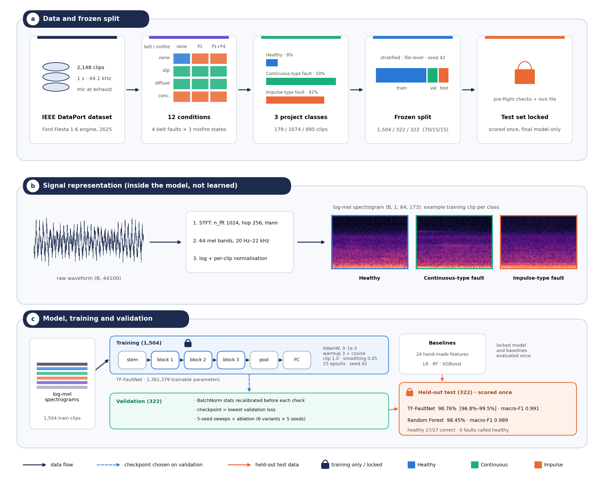

*(a) data and frozen split, (b) in-model signal representation, (c) model, training and validation. All numbers are read from the result files by `scripts/draw_methodology.py`.*

**Split** — Frozen stratified manifest `data/splits.csv`, column `split_multiclass_3class`, seed 42.

**Baselines** — Logistic Regression, Random Forest, and XGBoost trained on 24 handcrafted
statistical audio features establish that added complexity is warranted only where
it demonstrably improves on simpler models.

**Training** — AdamW (lr=1e-3, wd=1e-4), 3-epoch linear warmup then cosine decay to 1e-5 (stepped per batch), gradient-norm clipping at 1.0,
BatchNorm statistics re-estimated on clean training data before each validation pass,
batch size 64, 25 epochs, CrossEntropyLoss with label_smoothing=0.05, seed 42.
All hyperparameters sourced from `configs/experiment_3class.json`.

**Evaluation** — Run from the frozen NPZ archive. Two inference modes (raw waveform and
pre-computed spectrogram) are compared; 100 % output consistency is verified.

### EDA — Signal profiles per class

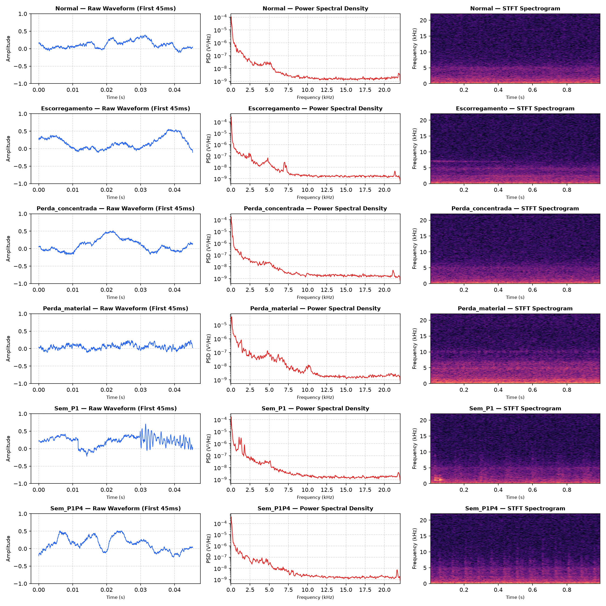

*Time-domain waveform and frequency-domain profiles for each of the 3 macro classes.
The three classes are visually separable in both domains.*

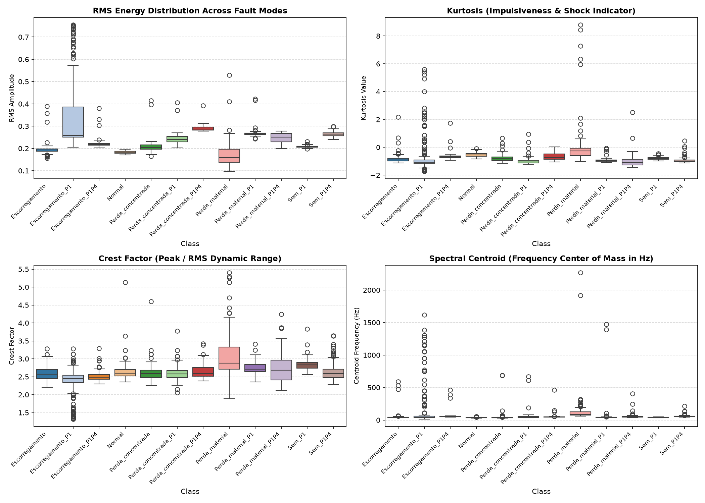

*Distribution of 24 handcrafted statistical features across classes.
Separability in feature space is consistent with Random Forest reaching 98.5 %.*

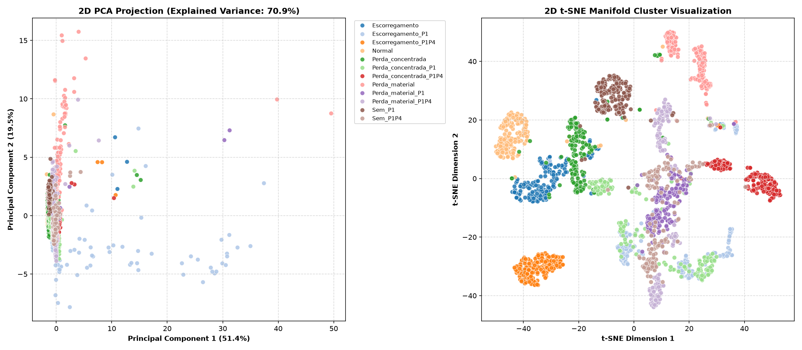

*t-SNE and PCA projections of the 24-feature space. Three well-separated clusters
show the classes are separable in this feature space. This does not show that the
grouping is physically meaningful.*

---

## Architecture

### Class acoustic signatures — the visual input to the CNN

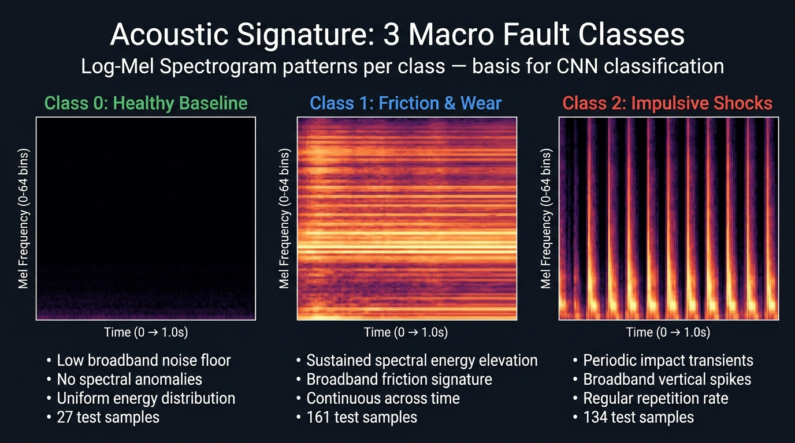

*The three classes produce visually distinct log-mel spectrogram patterns:
healthy (quiet), friction (horizontal bands), impulsive (vertical spikes).
This is why a 2D CNN is the right tool.*

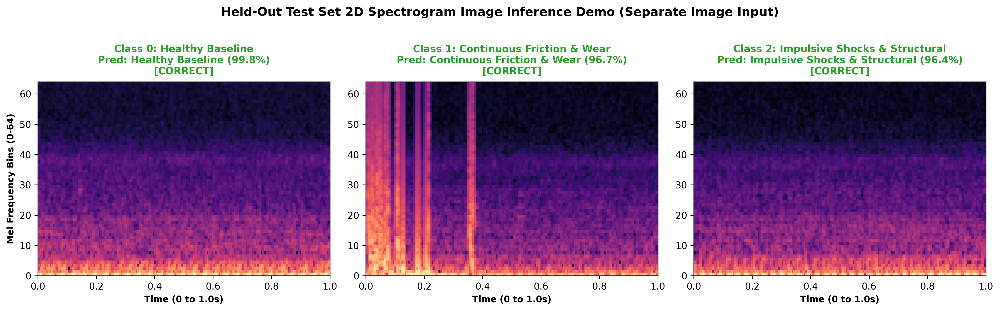

*Real log-mel spectrograms from the held-out test set, one per class.
Note the horizontal sustained bands in Class 1 and the periodic vertical spikes in Class 2.*

### TF-FaultNet forward pass

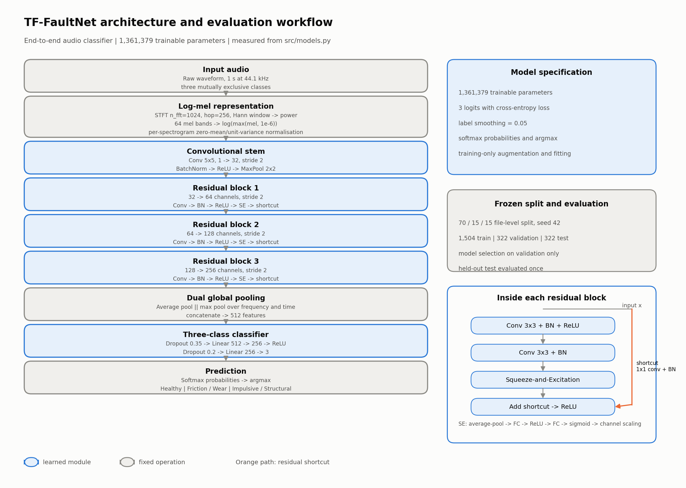

*Drawn from `src/models.py` by `scripts/draw_architecture.py`: the blocks run in sequence; shapes and parameter counts are measured. A plain-language version for non-technical readers: [`docs/assets/tffaultnet_overview_simple.png`](docs/assets/tffaultnet_overview_simple.png).*

```
(B, 44100) — raw waveform
    │
    ▼  LogMelSpectrogramExtractor  [STFT n_fft=1024, hop=256 · 64 Mel bins]
(B, 1, 64, 173)
    │
    ▼  Stem  Conv2d(1→32, 5×5, s=2) + BN + ReLU + MaxPool
(B, 32, 16, 43)
    │
    ▼  Layer 1  ConvBlock2D(32→64,   s=2)  [3×3 residual + SE]
    ▼  Layer 2  ConvBlock2D(64→128,  s=2)  [3×3 residual + SE]
    ▼  Layer 3  ConvBlock2D(128→256, s=2)  [3×3 residual + SE]
(B, 256, 2, 6)
    │
    ├── AdaptiveAvgPool → (B, 256)
    └── AdaptiveMaxPool → (B, 256)   →  Concat → (B, 512)
    │
    ▼  Dropout(0.35) → FC(512→256) → ReLU → Dropout(0.2) → FC(256→3)
    │
(B, 3) logits → softmax → argmax → ŷ ∈ {Healthy, Friction/Wear, Impulsive/Structural}
```

**1,361,379 trainable parameters (~1.36 M).** ConvBlock2D = Conv3×3 + BN + ReLU → Conv3×3 + BN →
SE-Attention (global avg → FC bottleneck → sigmoid scale) → residual add → ReLU.

---

## Results

### Test-set performance — N = 322, held out (final locked run)

| Model | Accuracy | Macro F1 | Macro ROC-AUC |
|-------|----------|----------|---------------|
| Logistic Regression | 84.16 % | 0.8795 | — |
| Random Forest (200 trees) | 98.45 % | 0.9886 | — |
| XGBoost (200 trees, d=6) | 97.83 % | 0.9840 | — |
| **TF-FaultNet (proposed)** | **98.76 %** | **0.9909** | **0.99985** |

### Per-class breakdown

| Class | Precision | Recall | F1 | ROC-AUC | N |
|-------|-----------|--------|----|---------|---|
| 0 · Healthy Baseline | 1.0000 | 1.0000 | 1.0000 | 1.0000 | 27 |
| 1 · Continuous Friction & Wear | 0.9816 | 0.9938 | 0.9877 | 0.99973 | 161 |
| 2 · Impulsive Shocks & Structural | 0.9924 | 0.9776 | 0.9850 | 0.99972 | 134 |

Best checkpoint: **Epoch 13** · Val Loss 0.1875 · Val Accuracy 99.38 % · Val Macro F1 0.9954  
Test accuracy 95% Wilson interval: 96.85 %–99.52 % (318/322).

### Visualisations

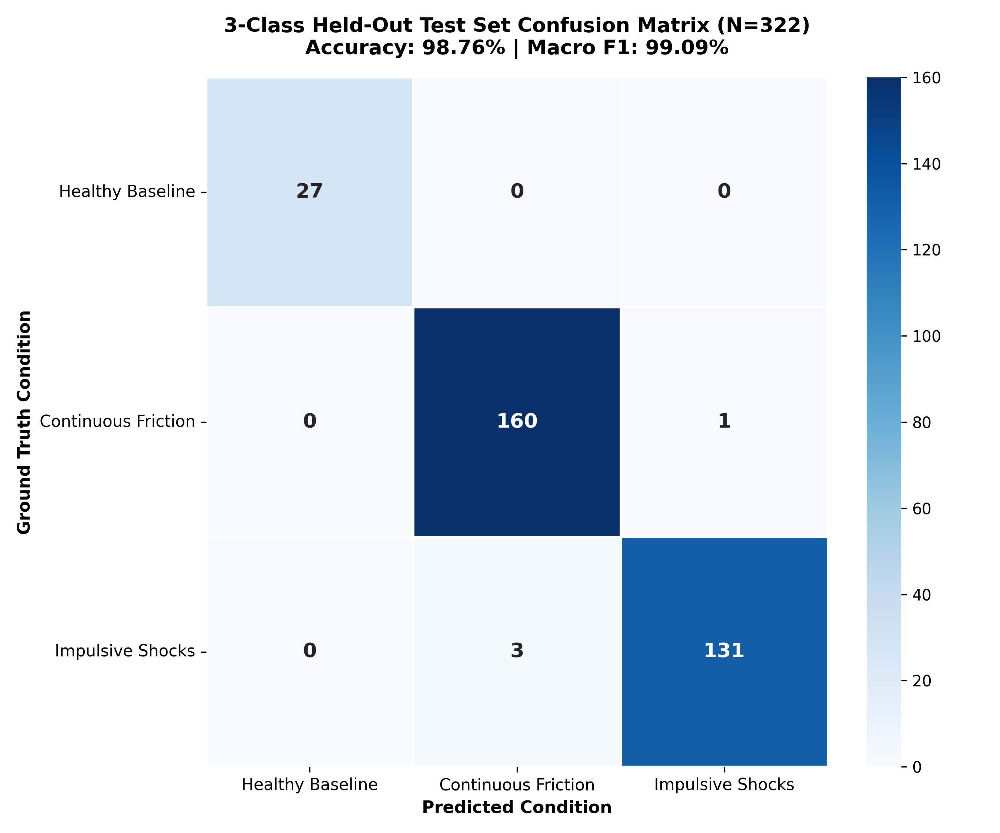

*3×3 confusion matrix on the 322-sample test set. Four errors, all between the two fault classes; no healthy clip is misclassified.*

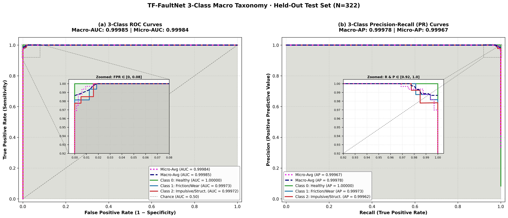

*Per-class one-vs-rest ROC and precision–recall curves on the test set.*

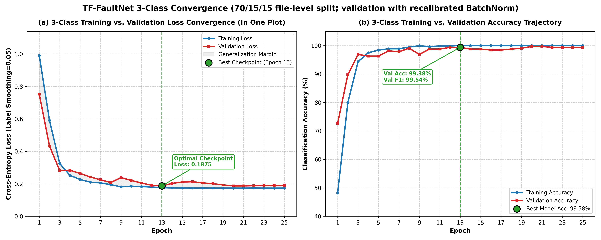

*Train / validation loss and accuracy over 25 epochs. Best checkpoint saved at epoch 13.*

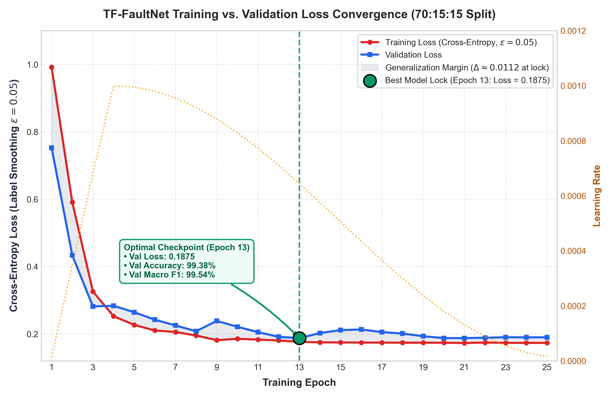

*Zoomed validation loss curve around the best epoch (13).*

---

## Novelty

The architecture combines known blocks (ResNet, SE attention, avg/max pooling, in-model
log-mel), so its novelty is not claimed. The contributions are:

- **Lightweight end-to-end triage model** — 1.36 M trainable parameters, raw audio in,
  in-model log-mel (no external audio library), ONNX/TorchScript export. Latency and a
  size–accuracy study are still to be measured.
- **Leakage-aware evaluation on a new dataset** — one reported (locked) test run, multi-seed validation,
  confidence intervals, matched classical baselines (Random Forest ties the CNN).
- **Dataset audit** — correlated clips (random splits are optimistic), effectively 8-bit
  audio, a DC/loudness shortcut, and a documented label inconsistency.
- **Controlled ablation (Round 4)** — only residual connections are clearly needed; dual
  pooling and SE give no measurable benefit (`results/ablations/ABLATION_STUDY.md`).
- **Diagnosis of validation-loss spikes** — traced to stale BatchNorm statistics and removed
  by recalibration (21 spikes → 0 in matched runs).

---

## Limitations

1. **Single-site data.** All recordings share the same lab rig, room acoustics, and transducer
   placement. Cross-rig generalisation is unknown.

2. **Session-level independence unverified.** File-level split non-overlap is confirmed.
   Whether recordings from the same fault session appear across train/test — sharing the
   same acoustic transfer function — cannot be determined without acquisition timestamps.
   *This is the central validity question for a rigorous thesis defence.*

3. **Most components are not justified.** In the Round 4 ablation (5 seeds, validation;
   `results/ablations/ABLATION_STUDY.md`) only the residual connections clearly help. SE
   attention, dual pooling and per-spectrogram normalisation show no measurable benefit.

4. **Closed-world performance.** 0.991 macro F1 reflects three coarse, acoustically distinct classes
   under controlled conditions — not a deployment-ready claim. The Random Forest baseline
   already reaches 98.45 % accuracy (macro-F1 0.9886).

5. **Stationary speed only.** Variable-speed conditions require order tracking or adaptive
   time-frequency methods.

---

## Reproduce

```powershell
pip install -r requirements.txt
python -m unittest discover -s tests -v      # unit tests
python scripts/verify_visualizations.py     # re-check every figure/number from saved files (no inference)
python evaluate_3class_test_set.py           # refuses: the final test run is locked (results/FINAL_TEST_EVALUATION.lock)
python scripts/baseline_comparison_3class.py # classical baselines
python ablation_study.py                     # 3-class ablation: 6 variants x 5 seeds, validation only
python train_3class_pipeline.py              # retrain from scratch
```

All artefacts: `configs/experiment_3class.json` · `data/splits.csv` · `results/checkpoints/` · seed 42.
